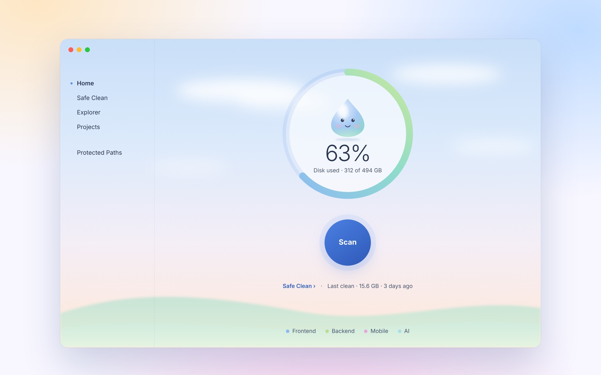

# Épurer

**Free up the space your developer tools quietly eat. Safely.**

macOS 14 or later · Apple silicon and Intel · Free

  

 

Build caches, `node_modules`, simulators, Docker images, downloaded models… they pile up until your disk is full. Épurer finds them, tells you what each one is and how safe it is to remove, and only deletes what you confirm.

## What it does

- **Scan in one click** and see how much space you can get back.
- **Safe Clean** removes only caches that rebuild on their own.
- **You stay in control.** Every item shows how safe it is, and nothing is deleted before you confirm.
- **Projects** finds old build folders in your projects. Your code is never touched.
- **Explorer** shows which folders take the most space.
- **Protected Paths** keeps the folders you choose out of every clean.
- **No admin password**, ever.
- **English and French**, following your Mac. Light and dark mode too.

## Install

1. [Download **Épurer.dmg**](https://github.com/0SansNom/epurer/releases/latest/download/Epurer.dmg).
2. Open it and drag **Épurer** into **Applications**.
3. Open Épurer.

> **The first time**, macOS may say it cannot check the app. Open **System Settings → Privacy & Security**, scroll down and click **Open Anyway**. You only do this once.

**See every cache (optional).** Épurer works right away. To see exact sizes everywhere, allow **Full Disk Access** when the app asks; it shows you where.

## Safe by design

Each item carries a level, so you always know what you are removing:

| | Level | What it is |
|---|---|---|
| 🟢 | **Safe** | Caches and logs that rebuild themselves |
| 🟡 | **Moderate** | Dependencies and build files, rebuilt on your next build |
| 🔴 | **Risky** | Backups and data you may want to keep. Never selected for you |

Deleted items are removed for good, not moved to the Trash. Use **Preview** to see exactly what would go before you clean.

## Works with

Xcode and simulators, Android Studio, Flutter · npm, yarn, pnpm, Bun, Next.js, Vite · Python, Rust, Go, Java, Ruby, PHP · Docker, Kubernetes, Terraform · Conda, Jupyter, PyTorch, Hugging Face · AI coding tools · Homebrew, system caches and the Trash.

## Help and feedback

Found a bug or have an idea? [Open an issue](https://github.com/0SansNom/epurer/issues).

Developers: the command line, building from source and releases are in [docs/DEVELOPMENT.md](docs/DEVELOPMENT.md).

Free and open source under the [MIT license](LICENSE).
